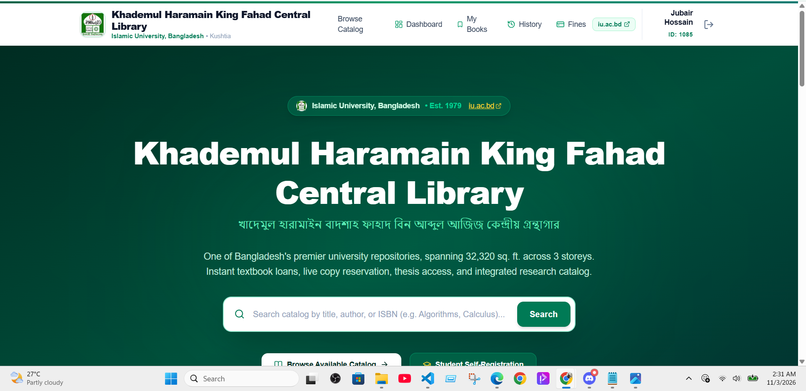
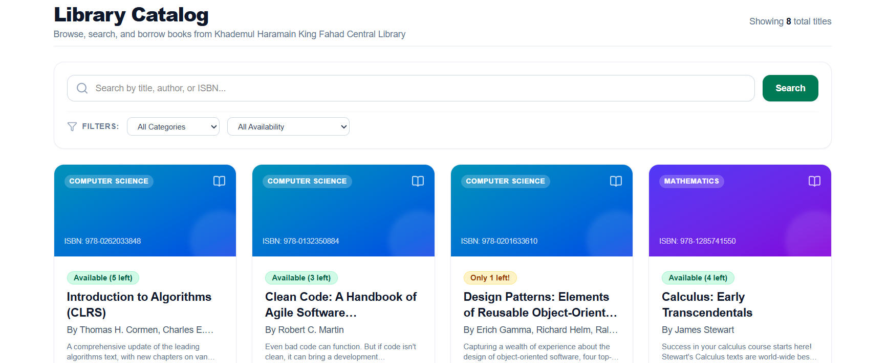
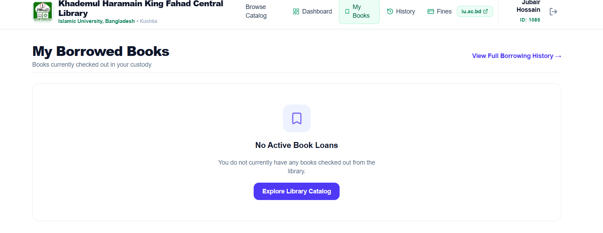
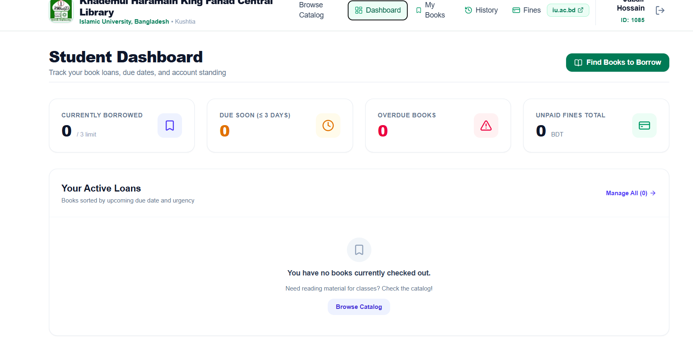
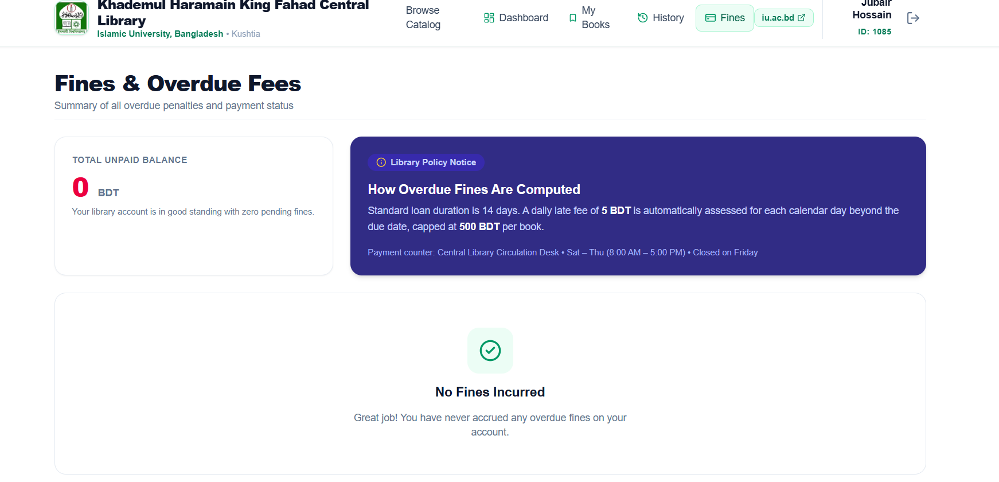
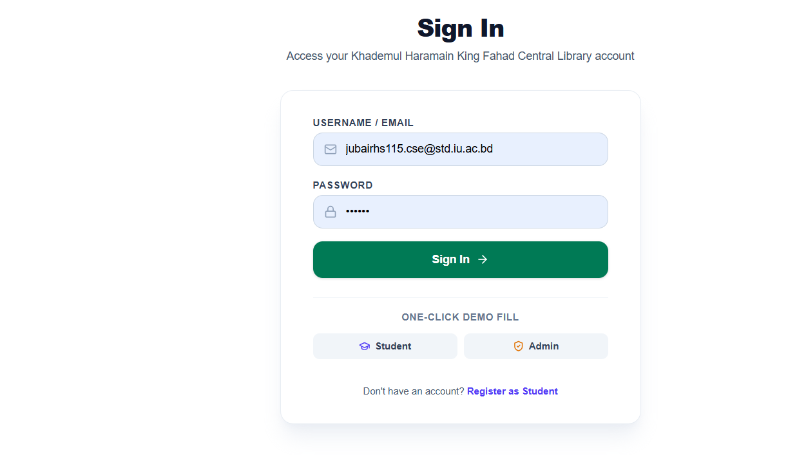
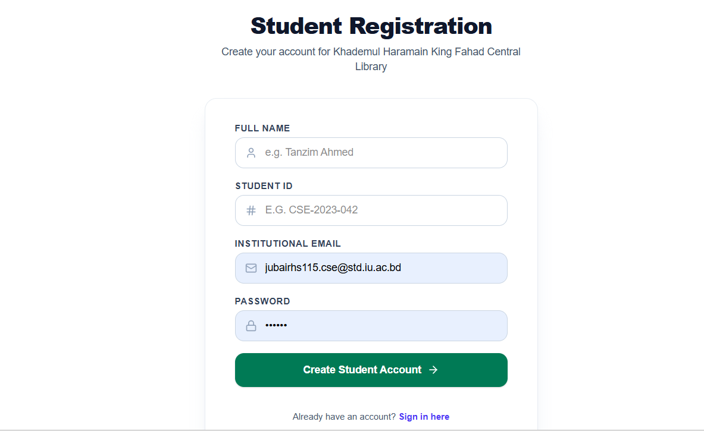

# 📚 Library Management System

A modern web-based Library Management System built with Next.js, React, MongoDB, and Better Auth. The application is designed to simplify library operations, manage books, and organize borrowing and returning activities.

<p align="center">
  <a href="https://project-seven-pearl-59.vercel.app/">
    
  </a>
  <a href="https://github.com/jubairhs115-cell/project">
    
  </a>
</p>

---

## 📖 About The Project

The Library Management System is a web application designed to make library activities easier, faster, and more organized.

It provides a digital platform where users can explore library books and manage book-related activities. The system is built with a modern frontend, database integration, and authentication functionality.

## ✨ Key Features

### 🔐 Authentication & User Management
- User registration and login.
- Secure authentication using Better Auth.
- User session management.
- User account access.

### 📚 Book Management
- Browse available library books.
- View book details.
- Search for books.
- Manage book information.

### 📖 Borrowing & Returning
- Borrow available books.
- Track borrowed books.
- Manage book return operations.
- Monitor book availability.

### 🎨 User Interface
- Responsive user interface.
- Modern design using Tailwind CSS.
- Reusable components with React and HeroUI.
- Navigation between application pages.

## 🛠️ Technologies Used

### Frontend Development
- Next.js
- React
- JavaScript (JSX)
- Tailwind CSS
- HeroUI

### Authentication
- Better Auth

### Database
- MongoDB

### Tools & Platforms
- Git
- GitHub
- Visual Studio Code
- Vercel

## 🚀 Getting Started

Follow these instructions to run the project locally.

### Prerequisites

Make sure you have installed:

- Node.js
- npm
- Git

### Installation

**1. Clone the repository**

```bash
git clone https://github.com/jubairhs115-cell/project.git
```

**2. Navigate to the project directory**

```bash
cd project
```

**3. Install dependencies**

```bash
npm install
```

**4. Configure environment variables**

Create a `.env.local` file in the root directory and configure the required environment variables.

For example, your project may require:

```env
MONGODB_URI=your_mongodb_connection_string
BETTER_AUTH_SECRET=your_auth_secret
BETTER_AUTH_URL=http://localhost:3000
```

Use the exact variable names required by your application. Never publish real credentials, secrets, or API keys.

**5. Start the development server**

```bash
npm run dev
```

**6. Open the application**

Visit:

```text
http://localhost:3000
```

## 🌐 Live Deployment

The project is deployed using Vercel.

[Visit Live Application](https://project-seven-pearl-59.vercel.app/)

## 📂 Project Repository

[View Source Code on GitHub](https://github.com/jubairhs115-cell/project)

## 👨‍💻 Author

**Jubair Hossain**

Computer Science & Engineering Student | Aspiring Full-Stack Developer

- GitHub: [@jubairhs115-cell](https://github.com/jubairhs115-cell)
- Email: [jubairhs115@gmail.com](mailto:jubairhs115@gmail.com)

---


## 📸 Screenshots

### 🏠 Homepage


### 📚 Books Cart


### 📖 My Books


### 📊 Dashboard


### 💰 Fines Management


### 🔐 Sign In


### 📝 User Registration


<p align="center">
  ⭐ If you find this project interesting, consider giving it a star!
</p>
